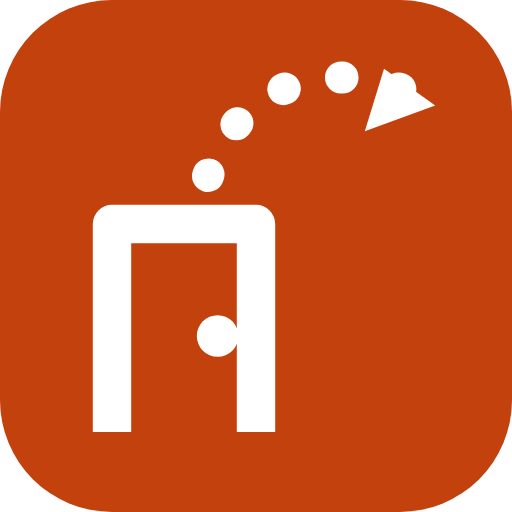

<p align="center"></p>

# Doorfarer

**Door-to-door trips for your AI assistant.** The nearest airport isn't always the best one. Doorfarer compares every
airport within reach of your home, adds the train, bus or drive to each, and finds the trip that's really cheapest or
fastest, door to door. A public MCP server: free, no account, nothing to install.

```
https://doorfarer.com/mcp
```

Transport: streamable HTTP. Authentication: none. Website: https://doorfarer.com

This repository holds the documentation and the registry manifest only. The service itself is hosted at doorfarer.com.

## Try it

Ask your assistant:

- "I live in New Haven. Cheapest way to Lisbon in March, about a week, two of us?"
- "I'm in Hartford and I'll drive to the airport. Fastest way to Rome in May, ten days?"
- "One way from Philadelphia to Dublin, sometime in April. What's cheapest?"
- "Where can I fly cheaply from Portland, ME this spring? Somewhere warm."

Doorfarer returns the cheapest, the fastest and the best balanced trip, each with the ground leg to its airport and a
booking link. It doesn't book hotels, and it isn't for a search from one airport you've already chosen.

## Tools

| Tool | What it does |
|---|---|
| `find_trips` | Finds round or one-way trips from a home town to a destination (airport, city, country, region or "anywhere"), ranked by price, travel time or a balance. Read-only. |
| `send_feedback` | Sends a short note to the maintainers when an answer looked wrong. |

## Add it to your assistant

The address is always `https://doorfarer.com/mcp`, no sign-in. Menus change; if a step looks different, the address is
all you need. A step-by-step page is at https://doorfarer.com/connect.

**Claude** (claude.ai, desktop, mobile): Customize → Connectors → Add custom connector → name `Doorfarer`, paste the
address, authentication "No sign in".

**Claude Code**

```bash
claude mcp add --transport http doorfarer https://doorfarer.com/mcp
```

**ChatGPT** (plans that allow custom MCP servers): add a custom MCP server with the address and no authentication,
then mention Doorfarer in a chat. Steps: https://doorfarer.com/connect.

**VS Code** (`.vscode/mcp.json`, or "MCP: Add Server")

```json
{ "servers": { "doorfarer": { "type": "http", "url": "https://doorfarer.com/mcp" } } }
```

**Cursor** (`~/.cursor/mcp.json`)

```json
{ "mcpServers": { "doorfarer": { "url": "https://doorfarer.com/mcp" } } }
```

**Windsurf** (`~/.codeium/windsurf/mcp_config.json`)

```json
{ "mcpServers": { "doorfarer": { "serverUrl": "https://doorfarer.com/mcp" } } }
```

**Gemini CLI** (`~/.gemini/settings.json`)

```json
{ "mcpServers": { "doorfarer": { "httpUrl": "https://doorfarer.com/mcp" } } }
```

**Hermes Agent** (`~/.hermes/config.yaml`)

```yaml
mcp_servers:
  doorfarer:
    url: "https://doorfarer.com/mcp"
```

Others:

- **Mistral Le Chat**: Connectors → Add Connector → Custom MCP Connector, name and address.
- **Grok**: Connectors → New Connector → Custom, paste the address.
- **Perplexity**: Settings → Connectors → Custom connector → Remote, paste the address.
- **Goose**: `goose configure` → Add Extension → Remote Extension (Streaming HTTP), paste the address.
- **JetBrains AI Assistant**: Settings → Tools → AI Assistant → Model Context Protocol, add `{"url": "https://doorfarer.com/mcp"}`.
- **Anything else that supports remote MCP servers**: use the address above.

## Prices, links and privacy

- Prices come from recent airline-fare searches on Aviasales, so they can change. The booking link opens a live search
  where the final price shows.
- **Booking links are affiliate links.** Doorfarer may earn a commission if you book, at no extra cost to you. Results
  are ranked by price and travel time, never by commission. Details: https://doorfarer.com/affiliate-disclosure
- No account. What is processed and why: https://doorfarer.com/privacy
- Terms: https://doorfarer.com/terms · Imprint and contact: https://doorfarer.com/imprint · hello@doorfarer.com

## Registry

`server.json` is the manifest published to the official MCP Registry as `com.doorfarer/doorfarer`.

## License

The documentation and configuration in this repository are MIT licensed (see `LICENSE`). The Doorfarer name and
logo are not covered by that license, and the Doorfarer service is not open source.
